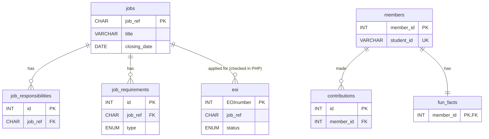

# Database design

Database: `hcm_thursdaymorning_09` (MySQL/MariaDB, utf8mb4). The settings live in `settings.php`.

Each table group has its own file in `sql/`. Every file drops and recreates its tables, so you can run it again at any time.

| File | Tables |
|---|---|
| `sql/eoi.sql` | eoi |
| `sql/jobs.sql` | jobs, job_responsibilities, job_requirements, perks |
| `sql/users.sql` | users |
| `sql/about.sql` | members, contributions, fun_facts |

## ERD

`perks` and `users` stand alone.

`eoi.job_ref` has no foreign key on purpose. Applications must survive if a job is closed or deleted, so `process_eoi.php` (not written yet) will check the reference against `jobs` instead.

All columns are NOT NULL unless the table says "null".

## Data dictionary

### eoi

One row per application sent from `apply.php`. Indexes: `job_ref`, and `(last_name, first_name)` for HR searches.

| Column | Type | Notes |
|---|---|---|
| EOInumber | INT UNSIGNED, PK, auto increment | Application number |
| job_ref | CHAR(5) | Form `job_ref`, e.g. FE001 |
| first_name | VARCHAR(20) | Form `first_name`, letters only |
| last_name | VARCHAR(20) | Form `last_name`, letters only |
| dob | DATE | Form `dob` (dd/mm/yyyy) saved as a date |
| gender | ENUM('female','male','other','not_say') | Form `gender` |
| street_address | VARCHAR(255) | Form `street_address`, stored escaped (form limit 40) |
| suburb | VARCHAR(255) | Form `suburb`, stored escaped (form limit 40) |
| state | ENUM('VIC','NSW','QLD','NT','WA','SA','TAS','ACT') | Form `state` |
| postcode | CHAR(4) | Form `postcode`, 4 digits |
| email | VARCHAR(255) | Form `email`, stored escaped |
| phone | VARCHAR(12) | Form `phone`, 8 to 12 digits |
| skill_html_css | TINYINT(1), default 0 | Skill box "HTML5 and CSS3" |
| skill_javascript | TINYINT(1), default 0 | Skill box "JavaScript" |
| skill_ui_ux | TINYINT(1), default 0 | Skill box "UI/UX design" |
| skill_python | TINYINT(1), default 0 | Skill box "Python" |
| other_skills | TEXT, null | Form `other_skills` (optional) |
| status | ENUM('New','Current','Final'), default 'New' | Set by the HR manager |
| created_at | DATETIME, default now | When the application arrived |

### jobs

| Column | Type | Notes |
|---|---|---|
| job_ref | CHAR(5), PK | FE001, FS002, UX003 |
| title | VARCHAR(100) | |
| team | VARCHAR(50) | |
| location | VARCHAR(100) | |
| work_type | VARCHAR(50) | |
| salary | VARCHAR(100) | Shown as text, e.g. "$95,000 to $120,000 a year plus super" |
| reports_to | VARCHAR(100) | |
| summary | TEXT | Paragraph under the job details |
| closing_date | DATE | Last day to apply. After it the job shows "Applications closed" |

### job_responsibilities

| Column | Type | Notes |
|---|---|---|
| id | INT UNSIGNED, PK, auto increment | |
| job_ref | CHAR(5), FK → jobs | Deleted with the job |
| sort_order | TINYINT UNSIGNED | Order in the list |
| description | VARCHAR(255) | |

### job_requirements

| Column | Type | Notes |
|---|---|---|
| id | INT UNSIGNED, PK, auto increment | |
| job_ref | CHAR(5), FK → jobs | Deleted with the job |
| type | ENUM('essential','preferable') | Which column it shows in |
| sort_order | TINYINT UNSIGNED | Order in the list |
| description | VARCHAR(255) | |

### perks

Shared by every job ("Working at SwinEduTech").

| Column | Type | Notes |
|---|---|---|
| id | INT UNSIGNED, PK, auto increment | |
| sort_order | TINYINT UNSIGNED | |
| description | VARCHAR(255) | |

### users

| Column | Type | Notes |
|---|---|---|
| id | INT UNSIGNED, PK, auto increment | |
| username | VARCHAR(50), unique | Seeded with `admin` |
| password_hash | VARCHAR(255) | From `password_hash()`, never plain text |
| failed_attempts | TINYINT UNSIGNED, default 0 | Wrong passwords in a row |
| locked_until | DATETIME, null | Login blocked until this time |
| created_at | DATETIME, default now | |

### members

| Column | Type | Notes |
|---|---|---|
| member_id | INT UNSIGNED, PK, auto increment | |
| full_name | VARCHAR(100) | |
| student_id | VARCHAR(10), unique | |
| quote_vi | VARCHAR(255) | Vietnamese saying |
| quote_translation | VARCHAR(255) | English meaning |
| sort_order | TINYINT UNSIGNED | Order on the page |

### contributions

| Column | Type | Notes |
|---|---|---|
| id | INT UNSIGNED, PK, auto increment | |
| member_id | INT UNSIGNED, FK → members | |
| part | TINYINT UNSIGNED | Assignment part, 1 or 2 |
| sort_order | TINYINT UNSIGNED | |
| description | VARCHAR(255) | |

### fun_facts

| Column | Type | Notes |
|---|---|---|
| member_id | INT UNSIGNED, PK, FK → members | One row per member |
| dream_job | VARCHAR(100) | |
| snack | VARCHAR(100) | Vietnamese name |
| snack_english | VARCHAR(100) | English meaning |
| hometown | VARCHAR(100) | |
